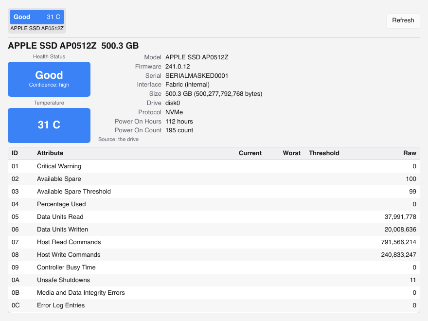
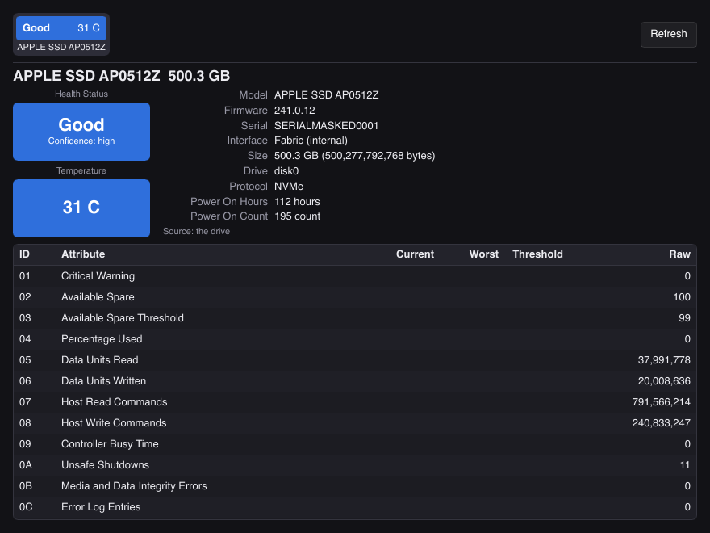

<div align="center">


# OnyxDiskInfo

### Reads the health of every disk, and tests, formats and erases it

_One tool, the same on Windows, on macOS, and on Linux._


[](LICENSE)
[](https://github.com/Stiven-Gjekaj/OnyxDiskInfo/actions/workflows/ci.yml)

<p align="center">
  <a href="#overview"><b>Overview</b></a> |
  <a href="#screenshots"><b>Screenshots</b></a> |
  <a href="#what-it-does"><b>Features</b></a> |
  <a href="#disks-without-smart"><b>Without SMART</b></a> |
  <a href="#the-shape-of-the-command"><b>Commands</b></a> |
  <a href="#install"><b>Install</b></a> |
  <a href="docs/roadmap.md"><b>Roadmap</b></a>
</p>

</div>

---

> [!NOTE]
> **The command line and the desktop app work.**
> `onyx list` shows each drive on Windows, on macOS, and on Linux.
> `onyx health` reads an NVMe drive on all three hosts, and agrees with
> smartctl. A drive that reports nothing gets a measured record with a low
> confidence. A SATA drive in a USB case reads through SAT on Windows, and
> agrees with smartctl. The Linux and macOS paths for SATA wait for a test.
> `onyx scan`, `onyx bench`, and `onyx test` work. The capacity test finds a
> fake drive. The comparison of the benchmarks with fio is partly proven.
> The desktop app shows the same values as `onyx health` on all three hosts.
> `onyx format` and `onyx erase` work, and each host checks and mounts each
> file system that Onyx writes. The erase commands of the firmware wait for
> a drive to test them.
> [docs/roadmap.md](docs/roadmap.md) says what comes next, and
> [docs/milestones.md](docs/milestones.md) holds every decision and the reason
> behind it.

## Overview

OnyxDiskInfo reads what a disk says about its own health.
It reads SATA, NVMe, USB, SD, and eMMC disks.
It also tests a disk, partitions it, formats it, and erases it.

It has two faces that share one library:

- `onyx`, a command line that gives each result as text or as JSON.
- `OnyxDiskInfo`, a desktop app in the style of CrystalDiskInfo.

## Screenshots

The desktop app on the internal SSD of a MacBook Air. It follows the light or
the dark scheme of the system.

<p align="center">
  
  
</p>

## What it does

| Area | Work |
|---|---|
| Health | ATA SMART, the NVMe health log, SCSI log pages, eMMC life estimates, the temperature, and a health score. |
| Bridges | SAT pass-through for a drive in a USB case. `smartctl` is a fallback if it is on your computer, and it reads the JMicron, ASMedia, and Realtek bridges until Onyx can test its own commands for them. |
| Tests | A surface scan, a write and verify test, a fake capacity test, and benchmarks. |
| Layout | GPT and MBR. Onyx writes FAT12, FAT16, FAT32, and exFAT itself. The tools of the host write NTFS, ext4, btrfs, XFS, APFS, and HFS+. |
| Erase | Overwrite passes and a full TRIM. ATA Secure Erase, NVMe Format, and NVMe Sanitize come next. |
| History | Each reading goes into SQLite. A worse verdict, more damage, or more wear makes an alert. The app charts the temperature, and a tray icon reads the drives each hour. |

## Disks without SMART

A cheap flash drive, a card reader, or a virtual disk reports no health.
Onyx still gives it a record.
The record holds the surface scan errors, the read latency over time, the fake
capacity result, and the benchmark trend.

Each health result has a confidence level.
A value that Onyx measures never looks like a value that the disk reports.

## The shape of the command

```
onyx list
onyx health <number> [--json]
onyx scan <number> [--json]
onyx bench <number> [--json]
onyx bench --file <path> [--size-mib 1024] [--keep] [--reuse] [--json]
onyx test capacity <number> [--force] [--confirm "<model> <size>"]
onyx test write <number> [--force] [--confirm "<model> <size>"]
onyx format <number> --fs exfat [--table mbr|gpt] [--label NAME]
onyx erase <number> [--pass zero|ones|random]... [--no-check]
onyx erase <number> --trim
onyx watch [--once] [--interval 3600] [--db <path>]
onyx history [<number>] [--db <path>]
onyx alerts [--db <path>]
```

`scan` reads every block and sorts each one by its read time, like MHDD and
Victoria. `bench` runs the four jobs of CrystalDiskMark: on a drive it only
reads, and in a test file it reads and writes, then deletes the file.
`test capacity` finds a fake drive that claims more space than it has. It
saves the blocks that it writes over and puts them back. `test write` writes
every block and reads each one back, and it erases the drive.
`format` writes a new table with one partition, and a file system in it.
`watch` reads every drive, keeps each reading, and prints the alerts that
it gives. `history` and `alerts` show what the history holds.
`erase` writes one pass of zeros by default and reads it back. `--trim`
takes seconds on a flash drive, and Onyx then reads a sample and says how
many blocks still give old bytes.

A command that reads never writes.
A command that writes asks you to confirm the drive, and it refuses the disk
that the running system starts from.

## Install

Homebrew, on macOS and on Linux. The first line installs the command line,
and the second installs the app on macOS:

```bash
brew install stiven-gjekaj/tap/onyxdiskinfo
brew install --cask stiven-gjekaj/tap/onyxdiskinfo
```

Scoop, on Windows. It installs the command line and the app:

```powershell
scoop bucket add stiven-gjekaj https://github.com/Stiven-Gjekaj/scoop-bucket
scoop install stiven-gjekaj/onyxdiskinfo
```

winget, on Windows, after Microsoft accepts the package:

```powershell
winget install Stiven-Gjekaj.OnyxDiskInfo
```

Or download a file from the
[releases](https://github.com/Stiven-Gjekaj/OnyxDiskInfo/releases).
[docs/releasing.md](docs/releasing.md) says what each file is, and how to
check that it came from this repository.

No paid certificate signs the app. macOS asks before it opens the app the
first time: open System Settings, then Privacy & Security, and choose Open
Anyway.

## Build

```bash
cargo build --release
```

The toolchain version is in [rust-toolchain.toml](rust-toolchain.toml).
[CONTRIBUTING.md](CONTRIBUTING.md) holds the checks that a change must pass.

## Not affiliated

OnyxDiskInfo has no connection to CrystalDiskInfo or to its author.
CrystalDiskInfo is the model for the health view, and nothing more.

## Support

If you find OnyxDiskInfo useful, you can support its development here.

[](https://ko-fi.com/U1G623RXOE)

## License

MIT. See [LICENSE](LICENSE) and [TERMS.md](TERMS.md).
