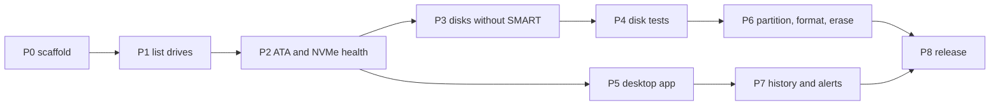

  <a href="../README.md"><b>OnyxDiskInfo</b></a>

# The roadmap

[docs/milestones.md](milestones.md) says what Onyx does and why.
This file says in what order to build it.

Each phase has a goal, the work in it, and an exit test.
Do not start a phase until the phase it depends on passes its exit test.
Each phase is many small commits.

P0 and P1 are done. `onyx list` runs on Windows, on macOS, and on Linux.
P2 passes its exit test for NVMe drives. The SATA half waits for a SATA
drive.
P3 is next. The owner chose on 2026-10-10 to start it while the SATA half
of P2 stays open, because no SATA drive is at hand.

---

## P0: the scaffold

Work:

- The workspace, `rust-toolchain.toml`, the lints, `clippy.toml`, and
  `rustfmt.toml`.
- README, CHANGELOG, CODE_OF_CONDUCT, CONTRIBUTING, SECURITY, SUPPORT,
  TERMS, and LICENSE.
- `.github`: CI, CODEOWNERS, FUNDING, and the issue and pull request
  templates.
- The `.githooks/pre-commit` hook.
- The public repository on GitHub.

Exit test: CI passes on Windows, on macOS, and on Linux.

## P1: list the drives

Work: `onyx list` shows each drive.
It shows the model, the serial number, the firmware, the size, the bus, and
the transport.
It covers internal, USB, SD, and NVMe drives.

Exit test: on each host, `onyx list --json` agrees with the host tool.
The host tools are `diskutil`, `lsblk`, and `Get-Disk`.
`scripts/check-list.py` makes the comparison, and CI runs it on each host.

Result: done.
The set of drives and the size of each drive agree on all three hosts.
The serial number and the firmware agree on Linux and on Windows.
`diskutil` gives neither, so on macOS they were compared by hand with
`system_profiler`, on one Mac with an internal SSD and three USB sticks.
Five CI runs passed, on Hyper-V SCSI and NVMe disks and on macOS disk images.

Open: one Linux runner gave the serial `2` from its virtual disk, and `lsblk`
gave the NAA name. That runner did not come back in four later runs.
The script prints the sources of the serial when this happens again.

## P2: ATA and NVMe health

Work: `onyx-core` decodes ATA SMART attributes, thresholds, and the self
test log.
It also decodes the NVMe health log.
`onyx health <drive>` shows them with a health score and a temperature.

Exit test: on each host, the values agree with `smartctl -a` for one SATA
drive and one NVMe drive.
A test decodes a raw byte dump from each drive.

Result for NVMe: done.
`scripts/check-health.py` compares `onyx health --json` with
`smartctl --json -a`, and CI runs it on each host.

- macOS: an APPLE SSD AP0512Z, through NVMeSMARTLib, by hand. The macOS
  runner has only virtual disks, and neither tool reads them.
- Linux: the MSFT NVMe Accelerator of the runner, with sudo, in CI.
- Windows: the Virtual_Disk NVME Premium and the Microsoft NVMe Direct Disk
  v2 of one runner, in CI. Other Windows runners have only SCSI virtual
  disks, and neither tool reads them.

The decoder test of the NVMe health log and of Identify Controller uses the
bytes of the APPLE SSD, captured with `smartctl -r ioctl,2`.

Open for SATA:

- No SATA drive was at hand. The ATA decoders are tested against blocks
  built from the ACS layout, and not against a captured dump.
- The Linux and the Windows shims send IDENTIFY DEVICE and the SMART reads
  through ATA PASS-THROUGH. No SATA drive has answered them yet.
- macOS has no ATA path yet. It needs `IOATASMARTInterface`.

## P3: disks without SMART

Work:

- SAT pass-through, and the JMicron, ASMedia, and Realtek bridge commands.
- eMMC EXT_CSD and the SD health register.
- The `smartctl --json` fallback.
- A confidence level on each health result.

Exit test: a SATA drive in a USB case shows its SMART.
A USB flash drive with no SMART shows a record with a low confidence level.

## P4: disk tests

Work:

- A read only surface scan with a map of the slow and the bad blocks.
- A write and verify test.
- A fake capacity test.
- Sequential, random, QD1, and QD32 benchmarks.

Exit test: the fake capacity test finds a disk image that claims more space
than it has.
The benchmark numbers on one drive are within 10 percent of CrystalDiskMark
or `fio`.

## P5: the desktop app

Work: a Slint app with one tab for each drive.
It shows the health badge, the temperature, and the attribute table, like
CrystalDiskInfo.
It also decides how the app gets administrator rights.

Exit test: the app shows the same values as `onyx health` on all three hosts.

## P6: partition, format, and erase

Work:

- GPT and MBR.
- FAT12, FAT16, FAT32, and exFAT, written by Onyx.
- NTFS, ext4, btrfs, XFS, APFS, and HFS+, written by the host tools.
- ATA Secure Erase, NVMe Format, NVMe Sanitize, a full TRIM, and overwrite
  passes.

Exit test: each host mounts each file system that Onyx writes.
A file system that Onyx writes passes `fsck` on Linux.

## P7: history and alerts

Work: SQLite history, trend charts, alerts when a value changes, and a tray
icon.

Exit test: a value that changes between two polls makes an alert.

## P8: the release

Work: the release workflow, the build attestation, and the Homebrew, Scoop,
and winget manifests.

Exit test: each package manager installs the release on a clean host.
