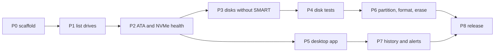

  <a href="../README.md"><b>OnyxDiskInfo</b></a>

# The roadmap

[docs/milestones.md](milestones.md) says what Onyx does and why.
This file says in what order to build it.

Each phase has a goal, the work in it, and an exit test.
Do not start a phase until the phase it depends on passes its exit test.
Each phase is many small commits.

P0 and P1 are done. `onyx list` runs on Windows, on macOS, and on Linux.
P2 passes its exit test for NVMe drives, and for a SATA drive on Windows.
The owner chose on 2026-10-10 to start P3 while the SATA half of P2 stays
open, because no SATA drive is at hand.
P3 is done on Windows. A SATA drive in a USB case waits for Linux and
macOS.
P4 is done but for its benchmark half, which is partly proven.
P5 is done. P6 is done but for the erase commands of the firmware, which
wait for a drive to test them. P7 is done but for a look at the tray icon on
a screen. P8 is done but for winget, where Microsoft reviews the package.
Version 0.1.0 is out.

---

## P0: the scaffold

Work:

- The workspace, `rust-toolchain.toml`, the lints, `clippy.toml`, and
  `rustfmt.toml`.
- README, CHANGELOG, CODE_OF_CONDUCT, CONTRIBUTING, SECURITY, SUPPORT,
  TERMS, and LICENSE.
- `.github`: CI, CODEOWNERS, FUNDING, and the issue and pull request
  templates.
- The `.githooks/pre-commit` hook.
- The public repository on GitHub.

Exit test: CI passes on Windows, on macOS, and on Linux.

## P1: list the drives

Work: `onyx list` shows each drive.
It shows the model, the serial number, the firmware, the size, the bus, and
the transport.
It covers internal, USB, SD, and NVMe drives.

Exit test: on each host, `onyx list --json` agrees with the host tool.
The host tools are `diskutil`, `lsblk`, and `Get-Disk`.
`scripts/check-list.py` makes the comparison, and CI runs it on each host.

Result: done.
The set of drives and the size of each drive agree on all three hosts.
The serial number and the firmware agree on Linux and on Windows.
`diskutil` gives neither, so on macOS they were compared by hand with
`system_profiler`, on one Mac with an internal SSD and three USB sticks.
Five CI runs passed, on Hyper-V SCSI and NVMe disks and on macOS disk images.

Open: one Linux runner gave the serial `2` from its virtual disk, and `lsblk`
gave the NAA name. That runner did not come back in four later runs.
The script prints the sources of the serial when this happens again.

## P2: ATA and NVMe health

Work: `onyx-core` decodes ATA SMART attributes, thresholds, and the self
test log.
It also decodes the NVMe health log.
`onyx health <drive>` shows them with a health score and a temperature.

Exit test: on each host, the values agree with `smartctl -a` for one SATA
drive and one NVMe drive.
A test decodes a raw byte dump from each drive.

Result for NVMe: done.
`scripts/check-health.py` compares `onyx health --json` with
`smartctl --json -a`, and CI runs it on each host.

- macOS: an APPLE SSD AP0512Z, through NVMeSMARTLib, by hand. The macOS
  runner has only virtual disks, and neither tool reads them.
- Linux: the MSFT NVMe Accelerator of the runner, with sudo, in CI.
- Windows: the Virtual_Disk NVME Premium and the Microsoft NVMe Direct Disk
  v2 of one runner, in CI. Other Windows runners have only SCSI virtual
  disks, and neither tool reads them.

The decoder test of the NVMe health log and of Identify Controller uses the
bytes of the APPLE SSD, captured with `smartctl -r ioctl,2`.

Result for SATA: done on Windows.
On 2026-10-11 a KINGSTON SA400S37240G, firmware S3Z40107, in a VIA VL715 USB
case was read on Windows 11 Pro, as Administrator. `onyx health` read it
through SAT and `IOCTL_SCSI_PASS_THROUGH`: source bridge, confidence high,
verdict Good, 26 attributes. `scripts/check-health.py` compared it with
`smartctl -x -d sat`, and each value agreed. The decoder test reads the
IDENTIFY DEVICE, SMART READ DATA, and SMART READ THRESHOLDS blocks of that
drive, captured with `smartctl -r ioctl,2`, with the serial number masked.

Open for SATA:

- Linux sends the same commands through `SG_IO`. No SATA drive has answered
  them on Linux yet. A VM could not take the drive: the USB pass-through of
  UTM reset the bridge again and again.
- macOS has no ATA path yet. It needs `IOATASMARTInterface`, and for a USB
  case a SAT driver that the person installs.
- `onyx list` on Windows shows what the bridge says: the model without its
  last letter, the serial number of the bridge, and four characters of the
  firmware. `onyx health` shows what the drive says. The list asks no drive
  through pass-through, because that needs administrator rights.

## P3: disks without SMART

Work:

- SAT pass-through, and the JMicron, ASMedia, and Realtek bridge commands.
- eMMC EXT_CSD and the SD health register.
- The `smartctl --json` fallback.
- A confidence level on each health result.

Exit test: a SATA drive in a USB case shows its SMART.
A USB flash drive with no SMART shows a record with a low confidence level.

Result: the second half is done. The first half waits for a SATA drive in a
USB case.

- Done: each health record names its source and its confidence. A drive
  that reports nothing gets a measured record with a low confidence. CI
  proves it on all three hosts, on Hyper-V virtual disks and macOS disk
  images: 64 reads each, no failure, confidence low.
- Done: eMMC life estimates on Linux, from `life_time` and `pre_eol_info`.
  Tested against `sysfs` contents in the tests. No eMMC chip was at hand.
- Done: the `smartctl --json` fallback. Its test reads the JSON of the
  APPLE SSD. CI does not reach it, because no runner drive is one that
  smartctl reads and Onyx does not.
- Done: SAT through `SG_IO` on Linux and through `IOCTL_SCSI_PASS_THROUGH`
  on Windows.
- Done on Windows: a SATA drive in a USB case, which is the first half of
  the exit test. P2 above gives the result. Before it, on 2026-10-11 a Kingston SA400S37240 in a VIA VL715 case (USB
  2109:0715) was at hand, on the Mac only. macOS gives no program a SAT
  path to a USB disk without a driver, and smartctl failed there too. A
  Fedora VM in UTM took the case by USB pass-through, and `onyx list` showed
  the drive with the serial and the firmware that macOS shows. Then the
  first read of the kernel timed out, over UAS and over usb-storage, and the
  bridge reset again and again. Neither tool reached the drive there.
- Done: a real USB flash drive. On 2026-10-10, `sudo onyx health 2` on macOS
  read a 125.8 GB USB stick (VendorCo ProductCode, firmware 2.00). It has no
  SMART, and it got a measured record: 64 reads, no failure, a median of
  21.3 MB/s, the slowest read 52 ms, verdict Good, confidence low.
- Not done, by decision: the vendor commands of JMicron, ASMedia, and
  Realtek bridges. [milestones.md](milestones.md) says why.
- Not done, by decision: the SD health register, which is not a standard.

## P4: disk tests

Work:

- A read only surface scan with a map of the slow and the bad blocks.
- A write and verify test.
- A fake capacity test.
- Sequential, random, QD1, and QD32 benchmarks.

Exit test: the fake capacity test finds a disk image that claims more space
than it has.
The benchmark numbers on one drive are within 10 percent of CrystalDiskMark
or `fio`.

Result: done, on Linux in CI.

- `scripts/check-capacity.sh` builds a fake drive with the device mapper: 256
  MiB whose four quarters map onto the same 64 MiB of a loop device. Onyx
  calls it fake, finds that it wraps every 64 MiB, and brackets the real end
  between 66,960,896 and 67,223,552 bytes. A loop device of 64 MiB is the
  control, and Onyx calls it genuine.
- The benchmark half is partly proven, and not done.
  `scripts/check-bench.py` runs the jobs of CrystalDiskMark with fio and with
  `onyx bench --file`, on one shared test file, and fio runs twice. A job
  passes when Onyx is within 10 percent of the range of the two runs of fio.

  On a cloud runner of Linux, with libaio: all eight measurements passed in
  two runs, and failed in two. Two runs of fio in one job differed by up to
  28 percent there, so CI reports the check and does not fail on it.

  On the APPLE SSD of a MacBook Air, with posixaio: only the jobs with a
  queue of one compare, because macOS runs posixaio on four threads and fio
  cannot hold 32 jobs in the shared memory of macOS. The SEQ1M Q1T1 write
  and the RND4K Q1T1 write passed in each of four runs. The reads did not
  hold still: fio read the same file at 5.0 to 5.3 GB/s in one run and at
  1.4 to 2.1 GB/s in the next, and Onyx read 4K at 61 to 76 MB/s.

  What the check found and fixed on the way: a test file that another
  program writes is laid out in another way, and fio read such a file 20
  percent slower than its own. A queue of fio threads is not the queue of
  CrystalDiskMark: eight threads wrote at 11 GB/s on a drive that cannot.

  Open: a run on a quiet drive, or a side by side run with CrystalDiskMark on
  Windows.

What the first run of the capacity test found: a fake drive rarely puts its
real end on the start of a probe, so the first probe past the end reads back
from the middle of a probe below. The first version marked only the start of
each probe, and called that a dropped write. Each sector of 512 bytes now
carries its own address.

Not yet run on a real drive: the surface scan, the write test, and the
capacity test. They ran on memory, on files, and on the device mapper. A scan
of the USB stick of P3 takes about 100 minutes, and the write test erases it.

## P5: the desktop app

Work: a Slint app with one tab for each drive.
It shows the health badge, the temperature, and the attribute table, like
CrystalDiskInfo.
It also decides how the app gets administrator rights.

Exit test: the app shows the same values as `onyx health` on all three hosts.

Result: done.
`scripts/check-gui.py` starts the app with the MCP server of Slint and no
display, presses the tab of each drive, and reads what the window shows. It
compares the verdict, the confidence, the model, the serial number, the
firmware, the temperature, and the hours with `onyx health --json` for the
same drive. CI runs it on each host, and it passed in three runs in a row:
two NVMe drives or two Hyper-V disks on Windows, a Hyper-V disk on Linux,
and the virtual disk and eight disk images on macOS. On a MacBook Air it
passed for the internal SSD.

What the first run found: the app made a new model of the tabs each time a
drive answered, so a tab that a person or a screen reader held went away.
The app now changes the tabs in place.

Not yet run: the button that reads a drive with administrator rights. It
needs a person at the password dialog. Its command line and its quoting are
tested, and a real shell gave the path back unchanged.

## P6: partition, format, and erase

Work:

- GPT and MBR.
- FAT12, FAT16, FAT32, and exFAT, written by Onyx.
- NTFS, ext4, btrfs, XFS, APFS, and HFS+, written by the host tools.
- ATA Secure Erase, NVMe Format, NVMe Sanitize, a full TRIM, and overwrite
  passes.

Exit test: each host mounts each file system that Onyx writes.
A file system that Onyx writes passes `fsck` on Linux.

Result: done for the table, the format, the overwrite, and the TRIM.

- `scripts/check-format.py` formats an image with `onyx format` for each
  table and each file system that the host can write. The host attaches it,
  checks it with its own tool, mounts it, writes a file, reads the file back,
  and checks it again. CI runs it on each host, and all 37 layouts passed:
  - Linux: FAT12, FAT16, FAT32, exFAT, NTFS, ext4, btrfs, and XFS, on MBR
    and on GPT. `fsck.fat`, `fsck.exfat`, `ntfsfix`, `fsck.ext4`,
    `btrfs check`, and `xfs_repair` found no fault, before and after the
    write.
  - macOS: FAT12, FAT16, FAT32, exFAT, and HFS+ on MBR and on GPT, and APFS
    on GPT. `fsck_msdos`, `fsck_exfat`, and `diskutil verifyVolume` found
    no fault.
  - Windows: FAT12, FAT16, FAT32, exFAT, and NTFS on MBR and on GPT, in a
    VHD. `chkdsk` found no fault. NTFS went through `onyx format` on the
    mounted VHD, by its number in `onyx list`.
- `scripts/check-erase.py` attaches an image of 0xA5 bytes as a disk on each
  host. `onyx erase --pass random --pass zero` left only zeros, with no bad
  block, on all three. After `onyx erase --trim`, 64 of 64 sample blocks
  read zeros from the loop device of Linux, and 0 of 64 from the disk images
  of macOS and Windows, which take the TRIM and keep the bytes. Onyx prints
  that count.

What the work found:

- `fatfs` writes the FAT type that the size gives, and not the one that it
  is asked for. A FAT12 of 1 GiB came out as FAT16. Onyx now finds the type
  in a dry run and refuses before it writes.
- A flush on a macOS disk node failed with `ENOTTY`. `sync_all` sends
  `F_FULLFSYNC`, which only a file system takes. So the write test counted a
  bad block, and the capacity test stopped, on every macOS drive. Onyx now
  sends `DKIOCSYNCHRONIZECACHE` to a disk node.
- A benchmark job could end with no command and a speed of zero, when the
  host started a worker after the time of the job was up. Each worker now
  sends one command at least. A Windows runner found it.

Open: ATA Secure Erase, NVMe Format, and NVMe Sanitize. They need a drive
that can be erased to test them, and none is at hand.
[milestones.md](milestones.md) says why they wait.

## P7: history and alerts

Work: SQLite history, trend charts, alerts when a value changes, and a tray
icon.

Exit test: a value that changes between two polls makes an alert.

Result: done.
`scripts/check-watch.py` polls the drives of the host twice with
`onyx watch --once`. Between the two polls it lowers one count of damage of
the last reading in the history, so the second, real reading counts more.
CI runs it on each host, and each one gave the alert, the exit code 2, and
the alert in `onyx alerts`:

- Linux: the failed reads of the measured Hyper-V disk.
- macOS: the failed reads of a measured disk image.
- Windows: the media errors of the NVMe drive of the runner.

A test of `onyx-store` makes the same change in memory, with the same
result.

The desktop app keeps each reading, charts the temperature of the drive, and
shows its alerts. The GUI check of P5 still passes on each host.

What the work found:

- The macOS runner attaches disk images while a job runs: one GUI check saw
  5 drives in `onyx list` and 15 in the app. The check now reads again when
  the two differ.
- SQLite is C, and the checks of the other targets in CI have no C
  compiler for them. They now link a system SQLite, which a check never
  links.

Open: the tray icon. The app made it and ran with no error on a MacBook Air,
but the screen was locked, so nobody saw the icon. A test with no display
has no tray.

## P8: the release

Work: the release workflow, the build attestation, and the Homebrew, Scoop,
and winget manifests.

Exit test: each package manager installs the release on a clean host.

Result: done for Homebrew and Scoop. winget waits for the review of
Microsoft.

- Version 0.1.0 is out, from the tag `v0.1.0` on commit `42b747f`, after CI
  passed on that commit. The release workflow built nine files, hashed them,
  attested each one, and opened a draft. Each checksum and each attestation
  of the draft held before it was published.
- The formula and the cask are in
  [Stiven-Gjekaj/homebrew-tap](https://github.com/Stiven-Gjekaj/homebrew-tap),
  and the manifest is in
  [Stiven-Gjekaj/scoop-bucket](https://github.com/Stiven-Gjekaj/scoop-bucket).
- `check-install.yml` ran on clean runners and passed:
  - the checksum and the attestation of each of the nine files;
  - `brew install stiven-gjekaj/tap/onyxdiskinfo` on macOS and on Linux,
    and `onyx --version` gave `onyx 0.1.0`;
  - `brew install --cask stiven-gjekaj/tap/onyxdiskinfo` on macOS: the app
    is in /Applications, sealed, for both chips, at version 0.1.0;
  - `scoop install stiven-gjekaj/onyxdiskinfo` on Windows: `onyx 0.1.0`,
    `onyx list`, and the app.
- The winget manifest went to winget-pkgs in
  [pull request 450615](https://github.com/microsoft/winget-pkgs/pull/450615).
  It validates against the JSON schemas of 1.12.0, and each download matches
  its hash. The CLA is accepted on it.

What the work found:

- A test install from a local tap found two faults in the package scripts
  before the release: the cask script added a stray `}` to an address, and
  the winget script did not stop when a file was missing from the sums.
- The app has no paid certificate. Installed through the cask, it waits for
  the person to allow it once in Privacy & Security. Taking the quarantine
  mark off is not enough on macOS 15 and later. The bundle carries an ad hoc
  seal, so macOS does not call it damaged.
- Homebrew 7 has no `--no-quarantine`.

Open: winget. After Microsoft merges the pull request, run the install check
with `-f winget=true`.
